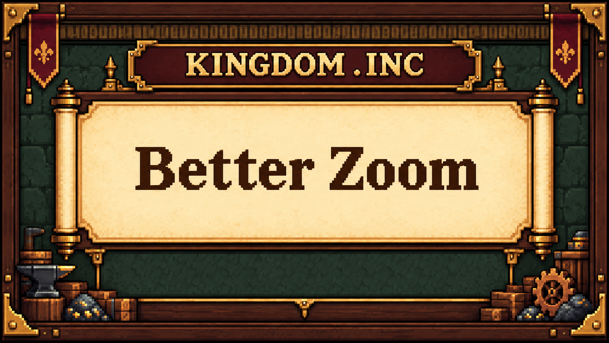

# Better Zoom

Zoom further out and in with the normal mouse wheel, in the workshop and research tree.

Version: 1.2.0. Author: urakkaamyx.



[GitHub releases](https://github.com/urakkaamyx/KingdomInc_BetterZoom/releases) · [Nexus Mods](https://www.nexusmods.com/kingdominc/mods/14)

## Unlock Better Zoom

Open **Tech Tree → Mods** and research **Better Zoom** for **100 gold**. This unlocks extended zoom in the workshop and both research tabs. Until then, normal zoom limits apply. Existing kingdoms also need to purchase this research.

- Three extra steps outward show up to eight times the normal visible width and height.
- Three extra steps inward provide up to eight times the normal maximum magnification.
- Zoom stays centered under your cursor.
- The research-tree background fills the screen at far zoom and while panning.
- Keyboard panning and Shift+wheel workshop switching retain their usual controls.

## Requirements and installation

Requires Kingdom Inc. for Windows x64 (Mono), BepInEx 5 x64, and Foundation 0.5.0 or later.

1. Install BepInEx and Foundation separately.
2. Close Kingdom Inc.
3. Extract `KingdomInc-BetterZoom-1.2.0.zip` into the folder containing `KingdomInc.exe`.
4. Confirm `BepInEx/plugins/BetterZoom/BetterZoom.dll` exists, then launch the game.
5. Open **Tech Tree → Mods** and research **Better Zoom**.

## Configuration

After the first launch, close the game and edit `BepInEx/config/urakka.kingdominc.betterzoom.cfg`:

```ini
[Zoom]
ExtraZoomOutLevels = 3
ExtraZoomInLevels = 3
```

Each extra step doubles or halves magnification. Choose 0 through 5 independently for each direction, then restart. Zero retains the normal limit in that direction. Research is still required before extra steps take effect.

## Updating and removal

Close the game before replacing the DLL. To remove Better Zoom, delete `BepInEx/plugins/BetterZoom`; its configuration file can also be deleted. Saved kingdoms remain usable.

The research unlock is saved with your kingdom. Extended camera views are temporary; reopening a view or restarting may restore a normal zoom level.

At far zoom, text and buildings become small. The background grid becomes coarser to fill the view. Keyboard panning uses the speed of the nearest normal zoom level.

## Changelog

1.2.0: Added fine-tuned zoom step sizing and Foundation ModConfig menu integration.

1.1.0: Add Better Zoom research under Tech Tree → Mods for 100 gold, unlocking the extra zoom range.

1.0.1: Fix the research-tree background ending inside the view at far zoom.

1.0.0: Initial release.

## Credits and support

Created for rockyamyx / urakkaamyx with AI-generated code, page text and promotional artwork.

For support, include your game version, Better Zoom version, configuration and `BepInEx/LogOutput.log` in a [GitHub issue](https://github.com/urakkaamyx/KingdomInc_BetterZoom/issues).